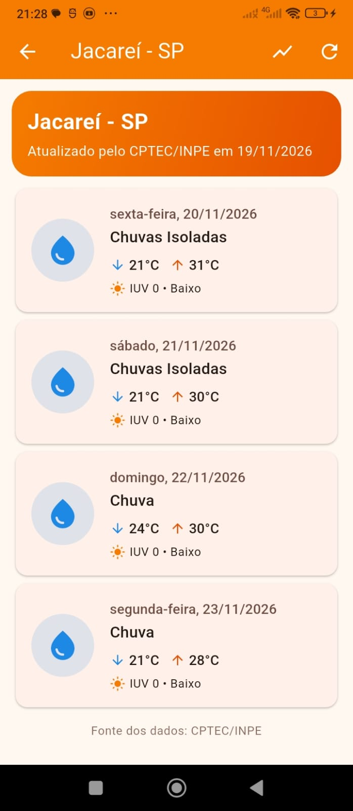
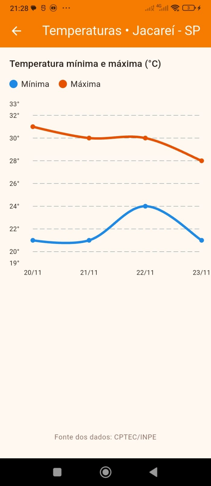

# Nome:
Joao Pedro Souza dos Anjos

# Previsão do Tempo (CPTEC/INPE)

Aplicativo Flutter com visual laranja para consultar a previsão do tempo de cidades brasileiras.
**Fonte dos dados: CPTEC/INPE** (https://servicos.cptec.inpe.br/XML/) — o crédito aparece em todas as telas.

Atividade 2 — Programação para Dispositivos Móveis II (Fatec).

## Funcionalidades implementadas

1. **Pesquisa de cidades**: consulta `listaCidades?city=` (acentos removidos, como exige o serviço). A lista mostra nome e UF; o código usado na previsão é o `id` retornado pelo próprio serviço. Mensagem específica quando nenhuma cidade é encontrada.
2. **Previsão de 4 dias** (`cidade/{id}/previsao.xml`): todos os dias retornados, cada um com data, temperatura mínima/máxima (°C), descrição da condição (as 40 siglas oficiais convertidas), ícone representativo e índice ultravioleta (com classificação), quando disponível. Exibe também a data de atualização informada pelo serviço.
3. **Gráfico de temperaturas** (mínima × máxima) com `fl_chart`.
4. **Atualização**: botão na barra superior e *pull-to-refresh*; indicador de carregamento em todas as consultas.
5. **Tratamento de erros**: falha de conexão, timeout, serviço indisponível (HTTP ≠ 200), XML/resposta inválida, previsão indisponível e campos ausentes (valores nulos viram `--`/“Condição não informada” sem encerrar o app).
6. **Navegação** entre 3 telas: pesquisa → previsão → gráfico.

## Persistência local

`shared_preferences` com dados em JSON:

- **Última cidade** selecionada e **histórico das 8 cidades recentes** (exibidos na tela inicial).
- **Cache da última previsão de cada cidade**: se a consulta falhar (sem internet/serviço fora), o app mostra a previsão salva com aviso “Sem conexão • dados salvos em …”.

## Como executar

Pré-requisitos: [Flutter SDK](https://docs.flutter.dev/get-started/install) 3.22+ e emulador/dispositivo.

```bash
dart tool/setup.dart   # gera pastas de plataforma, permissão INTERNET, dependências e ícone
flutter run
```

Manualmente:

```bash
flutter create --project-name previsao_tempo --org br.fatec .
# Android: adicione em android/app/src/main/AndroidManifest.xml, antes de <application>:
#   <uses-permission android:name="android.permission.INTERNET"/>
flutter pub get
dart run flutter_launcher_icons
flutter run
```

Testes: `flutter test` (parser XML, campos ausentes, siglas, UV).

> Execução no navegador (`flutter run -d chrome`): o serviço do CPTEC pode bloquear requisições de páginas web (CORS). Prefira Android/iOS/desktop.

## Bibliotecas

| Biblioteca | Uso |
|---|---|
| `http` | Requisições HTTP |
| `xml` | Leitura das respostas XML |
| `shared_preferences` | Persistência local |
| `fl_chart` | Gráfico de temperaturas |
| `intl` / `flutter_localizations` | Datas em português |
| `flutter_launcher_icons` | Ícone do app |

## Estrutura

```
lib/
  main.dart, theme.dart
  models/      city.dart, forecast.dart
  services/    cptec_service.dart, cptec_parser.dart, cptec_exception.dart
  data/        app_storage.dart
  utils/       weather_conditions.dart (siglas → descrição/ícone), text_utils.dart
  screens/     search_screen.dart, forecast_screen.dart, chart_screen.dart
  widgets/     message_view.dart
```

## Capturas de tela

Salve as imagens em `docs/screenshots/`:

| Pesquisa | Previsão | Gráfico | 
|---|---|---|
|  |  |  |
